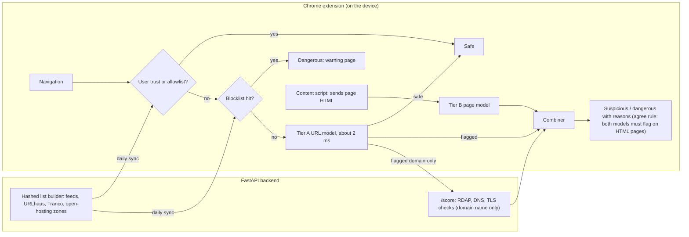

# PhishDrift

A phishing detector built to hold up outside its benchmark: six public datasets and live feeds
pooled under domain-level leakage controls, one in-house feature engine, three model tiers, and an
evaluation protocol (10 domain-grouped splits, a held-out source, the newest time slice and
naturally browsed legitimate pages) that treats a single benchmark score as untrustworthy. It ships
as a Chrome extension (Manifest V3) that scores addresses on the device, plus a FastAPI backend.
Design: [docs/PROJECT_SPEC.md](docs/PROJECT_SPEC.md). Prior study it builds on:
[docs/prior_work/](docs/prior_work/).

## Results

Medians over 10 domain-grouped splits; every number comes from a script in `experiments/` and its
report in `reports/`. Recall is measured at a fixed false-positive rate (FPR), the primary metric.

Medians over 10 domain-grouped splits; "agree" rule = suspicious banner on an HTML page requires
both the page model and the address model to exceed the 1% threshold. Every number comes from a
script in `experiments/` and its report in `reports/`.

| model / rule | evaluation set | URLs | recall @1% FPR | false alarms @1% | recall @0.1% FPR | false alarms @0.1% | source |
|---|---|---|---|---|---|---|---|
| shipped agree | test (all) | 84,036 | 73.5% | 0.9% | 60.0% | 0.1% | [blend2_rules.md](reports/blend2_rules.md) |
| shipped agree | test, rows with usable HTML | 26,011 | 88.5% | 0.4% | 86.6% | 0.2% | [blend2_rules.md](reports/blend2_rules.md) |
| shipped agree | newest time slice (PhreshPhish) | 80,653 | 80.7% | 0.8% | 66.7% | 0.2% | [blend2_rules.md](reports/blend2_rules.md) |
| shipped agree | held-out source (PhishStorm, URL-only) | 59,485 | 84.0% | 4.8% | 65.0% | 0.3% | [blend2_rules.md](reports/blend2_rules.md) |
| shipped agree | OOD legit pages (address model, 2,555 pages) | 2,555 | n/a | 5.3% | n/a | 1.1% | [blend2_rules.md](reports/blend2_rules.md) |
| shipped agree | OOD legit pages with HTML (2,226 pages) | 2,226 | n/a | 2.4% | n/a | 1.3% | [blend2_rules.md](reports/blend2_rules.md) |
| tier C + address (domain/DNS/TLS, live feeds) | 10-split test | 1,488 hosts | — | — | — | — | [tier_c.md](reports/tier_c.md) |

PhishStorm's 4.8% false alarms are from a 2014 URL-only source; the pooled threshold (fitted on
PhreshPhish-heavy data) does not transfer there. Source-robust `_ws` variants bring it to 3.9% at
−1.4 pp recall. Also measured: leave-one-source-out ([loso.md](reports/loso.md)), address
normalisation and shuffled-label controls ([hybrid2_checks.md](reports/hybrid2_checks.md),
[blend_checks.md](reports/blend_checks.md), [tier_b_checks.md](reports/tier_b_checks.md)), URL
evasion attacks ([robustness.md](reports/robustness.md)), IPW fairness correction
([blend2_fair.md](reports/blend2_fair.md)), backend domain rule rates
([domain_rules.md](reports/domain_rules.md)), and in-browser latency (1.6 ms per URL,
[latency.md](reports/latency.md)). Known limits: HTML results rest almost entirely on one source
(PhreshPhish), thresholds do not transfer across sources ([loso.md](reports/loso.md)), and the tier
C sample is small.

## How it works



The extension sends the backend only a domain name, and only for an address the on-device model
already flagged. The allowlist (Tranco top 50,000, hashed) skips learned open-hosting zones such as
`cloudapp.azure.com` and `drive.google.com`. Details: [extension/README.md](extension/README.md),
[docs/BACKEND.md](docs/BACKEND.md), every feature in
[docs/FEATURE_DICTIONARY.md](docs/FEATURE_DICTIONARY.md).

## Repository layout

| folder | what it holds |
|---|---|
| `phishdrift/` | shared schema, registrable domains, canonical URLs, cached HTTP client |
| `collector/` | live feeds every 12 h, benign inner-page crawler, first-seen RDAP/DNS/TLS capture |
| `data_pipeline/` | source loaders, pooled corpus build (dedup, leakage removal, depth check), splits, data card |
| `features/` | the feature engine: 99 URL (tier A), 84 HTML (tier B) and 29 domain (tier C) features |
| `models/`, `experiments/` | models, and every reported number (writes `reports/`) |
| `attacks/` | six URL evasion families for the robustness section |
| `js/`, `extension/` | JavaScript port of tier A (identical to Python on 272 URLs) and the MV3 extension |
| `backend/` | FastAPI service and hashed list builder |
| `demo/` | URL check page: paste an address, get the extension's verdict without the extension |

## Try the extension

```bash
cd extension && node build.mjs     # assembles extension/dist
```

Then open `chrome://extensions`, turn on Developer mode, choose **Load unpacked** and pick
`extension/dist`. After an update, click the reload arrow on the PhishDrift card. The backend is
optional (`uvicorn backend.app:create_app --factory`); without it the extension still scores
addresses and uses its bundled allowlist.

## Try the URL check page (no extension)

```bash
python -m demo        # from the repository folder; opens http://127.0.0.1:8765/demo/
```

Paste an address and each layer (allowlist, blocklist, address model, look-alike rules, combiner)
takes its own screen in turn and shows what it checked for that exact address: the domain and its hash
looked up in the list, the clues that built the model's score, the letters compared with the closest
brand, and the combiner's steps. It ends in the verdict (safe / suspicious / dangerous) with the reasons. It runs the extension's own address
layers in the browser tab (allowlist, blocklist from `data/lists/` when built, tier A model,
look-alike rules, combiner) and reads the model files from `js/data` on every load, so a
re-exported model shows up after a reload. It does not open the page, so the page model, the
login-form checks and the backend domain checks are not applied. No extra packages are needed;
`python -m http.server` from the repository root also works on Linux and macOS (on Windows it may
serve `.js` with the wrong type, which `python -m demo` avoids).

## Setup

```bash
python3.11 -m venv .venv && source .venv/bin/activate
pip install -e ".[dev,datasets]"
pytest && ruff check .
```

## Reproduce the data (milestone 1)

On Windows, `powershell -ExecutionPolicy Bypass -File scripts\run_milestone1.ps1` runs every step below from a fresh clone.

### 1. Get the sources

PhreshPhish (Hugging Face) and PhiUSIIL (UCI) download automatically. Put the others here
(only the URL, label, date and HTML are ever read; every precomputed feature column is ignored):

| Source | Put it in | Where to get it |
| --- | --- | --- |
| Phish360 | `data/raw/phish360/*.parquet` | from the dataset's authors (no public download link) |
| Phish-Blitz (PhishingSamples, phishing only) | `data/raw/phishblitz/openphish_urls_<N>_<DD>_<MM>_<YYYY>.txt` + extracted `openphish_phishing_resources_<N>/` | OneDrive link in the `Duddu-Hriday/Phish-Blitz` GitHub README; skip the 63.9 GB LegitimateSamples.zip |
| Phishpedia 30k | `data/raw/phishpedia/<site>/{info.txt,html.txt}` | Google Drive link in the Phishpedia GitHub README |
| URL-Phish | `data/raw/urlphish/*.csv` | Mendeley Data |
| PhishStorm | `data/raw/phishstorm/urlset.csv` | Aalto University PhishStorm page |

Check that each source's column names match `configs/datasets.yaml`:

```bash
python -m data_pipeline inspect phish360
```

### 2. Collect live data (every 12 hours)

```bash
# Optional credentials (environment variables, never committed):
export URLHAUS_AUTH_KEY=...      # free abuse.ch key (URLhaus is a blocklist only, never training data)
export PHISHTANK_APP_KEY=...     # PhishTank is skipped without it
export HF_TOKEN=...              # if the PhreshPhish dataset is gated for you

python -m collector run          # schedule it: scripts/cron_example.txt
```

One run fetches OpenPhish, Phishing.Database and PhishTank into the first-seen index, stores
URLhaus separately as a blocklist, crawls 3-5 robots.txt-allowed inner pages from a sample of
benign seed domains (Tranco, PhiUSIIL legitimate, URL-Phish benign), and records RDAP, DNS and
TLS facts for each new live host at first-seen time (tier C).

### 3. Build the pooled corpus

```bash
python -m data_pipeline build                 # load all sources, dedup, holdouts, 10 splits, data card
python -m data_pipeline seeds                 # (also run by build) crawl seeds from PhiUSIIL / URL-Phish
python -m collector crawl --seeds phiusiil urlphish   # inner pages for those seeds
python -m data_pipeline build --reuse-interim --reload phiusiil urlphish live   # add crawled pages
```

The build stops (exit code 3) if any URL-depth bucket of the training pool is more than 90%
one class, after writing `reports/data_card.md` so you can see which bucket. The fix is more
benign inner pages (crawl), not relaxing the check.

Outputs in `data/processed/`:

- `pool.parquet` training pool (with per-source class weights); `splits.parquet` assigns it to
  train / cal / test for 10 domain-grouped splits
- `heldout_source.parquet` (`holdouts.heldout_source` in `configs/datasets.yaml`; PhishStorm while Phish360 is unavailable), `time_slice.parquet` (PhreshPhish's later test split plus
  the newest live data), `eval_only.parquet` (natural legitimate pages): never trained on
- `manifest.json`; the data card in `reports/data_card.md` and tables in `reports/tables/`

Every split is by registrable domain (public suffix only): no domain is on two sides of any
split or holdout. `data/` is gitignored; datasets are never committed.
